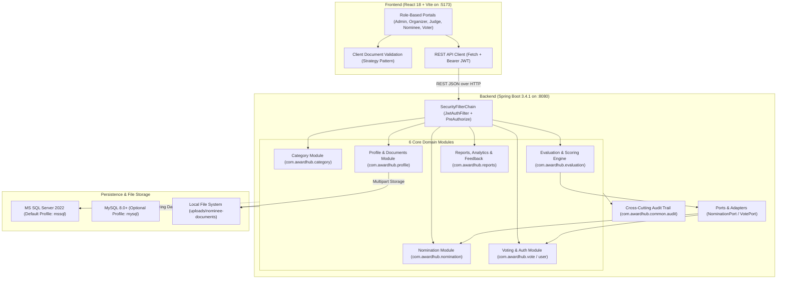

# AwardHub — Web-Based Voting & Award Nomination Management System


**AwardHub** is an end-to-end, role-based web application for managing award events, categories, candidate nominations, nominee portfolios & document verification, public voting, multi-criterion judge evaluations, and real-time reporting & analytics.

---

## Table of Contents

- [System Architecture](#system-architecture)
- [Core Domain Modules](#core-domain-modules)
- [Software Design Patterns](#software-design-patterns)
- [Role-Based Access Control (RBAC)](#role-based-access-control-rbac)
- [Getting Started](#getting-started)
  - [Prerequisites](#prerequisites)
  - [1. Database Configuration & Seeding](#1-database-configuration--seeding)
  - [2. Backend Setup (Spring Boot)](#2-backend-setup-spring-boot)
  - [3. Frontend Setup (React + Vite)](#3-frontend-setup-react--vite)
- [Quick Login Cheatsheet (Demo Accounts)](#quick-login-cheatsheet-demo-accounts)
- [REST API Overview](#rest-api-overview)
- [Project Directory Structure](#project-directory-structure)
- [Running Tests](#running-tests)
- [Contributors](#contributors)

---

## System Architecture

AwardHub follows a layered, modular monolith architecture on the backend paired with a responsive Single-Page Application (SPA) on the frontend.



---

## Core Domain Modules

### 1. Award Category & Event Management (`com.awardhub.category`)
- Manages award events, category definitions, eligibility rules, nomination windows, and voting schedules.
- Enforces strict category lifecycle transitions: `DRAFT` → `ACTIVE` → `VOTING_OPEN` → `VOTING_CLOSED` → `ARCHIVED`.
- Supports per-category evaluation criteria (`CategoryCriterion`) and judge panel assignments (`CategoryJudge`).

### 2. Nomination Management (`com.awardhub.nomination`)
- Allows nominees and users to draft, submit, update, and track award nominations across active categories.
- Supports organizer screening and moderation workflows with rejection reasons and status tracking (`DRAFT`, `SUBMITTED`, `UNDER_REVIEW`, `APPROVED`, `REJECTED`).

### 3. Nominee Profile & Document Verification (`com.awardhub.profile`)
- Provides dedicated candidate portfolios including biography, organization, achievements, social links, and public feed visibility.
- Handles multipart uploads and verification workflows (`PENDING`, `VERIFIED`, `REJECTED`) for 6 document types:
  - `NIC_PASSPORT_COPY`, `CV`, `CERTIFICATE`, `ACHIEVEMENT_PROOF`, `PROFILE_PHOTO`, and `OTHER`.

### 4. Public Voting & Account Administration (`com.awardhub.vote` & `com.awardhub.user`)
- Stateless JWT authentication (`/api/auth/login`, `/api/auth/register`) with BCrypt password hashing.
- Public ballot casting with NIC validation, voting-window enforcement, duplicate-vote prevention (one vote per voter per category), and vote withdrawal before deadlines.
- IT Coordinator & Admin user lifecycle governance (`ACTIVE`, `PENDING_VERIFICATION`, `SUSPENDED`, `DEACTIVATED`), role assignment, and credential resets.

### 5. Judge Evaluation, Scoring & Results Engine (`com.awardhub.evaluation`)
- Configurable category rubrics (`Rubric`, `RubricCriterion`) and evaluation schemes (`EvaluationScheme`).
- Supports 3 evaluation modes:
  - `HYBRID` (weighted combination of Judge Score + Normalized Public Votes)
  - `JUDGE_ONLY` (100% Judge Rubric Evaluation)
  - `PUBLIC_ONLY` (100% Public Vote Tally)
- Supports statistical score aggregation (`MEAN`, `TRIMMED_MEAN`, `MEDIAN`) and public vote normalization (`MAX_IN_CATEGORY`, `SHARE_OF_TOTAL`).
- Result set computation, tie detection, approval workflows, and official winner publication (`DRAFT` → `CALCULATED` → `PENDING_APPROVAL` → `PUBLISHED`).

### 6. Reports, Analytics & Feedback (`com.awardhub.reports`)
- Generates exportable system reports (`NOMINATION`, `VOTING`, `EVALUATION`, `WINNER`, `TIE`, `PARTICIPATION`) in `PDF`, `CSV`, and `EXCEL` formats.
- Captures real-time analytics snapshots (`AnalyticsSnapshot`) visualized via Recharts dashboards.
- Multi-role feedback and issue tracking (`PRAISE`, `SUGGESTION`, `BUG`, `COMPLAINT`) with status management (`OPEN`, `IN_PROGRESS`, `RESOLVED`, `CLOSED`) and threaded organizer replies (`FeedbackReply`).

---

## Software Design Patterns

### 1. Strategy Pattern (Full-Stack Document Validation)
Implemented in both the backend (`com.awardhub.profile.strategy`) and frontend (`awardhub-frontend/src/strategy`) to validate uploaded nominee documents dynamically based on `NomineeDocumentType`:
- **Strategy Interface / Base**: `DocumentValidationStrategy` & `AbstractDocumentValidationStrategy`
- **Concrete Strategies**:
  - `IdentityDocumentValidationStrategy` (`NIC_PASSPORT_COPY`)
  - `CvValidationStrategy` (`CV`)
  - `EvidenceDocumentValidationStrategy` (`CERTIFICATE`, `ACHIEVEMENT_PROOF`)
  - `ProfilePhotoValidationStrategy` (`PROFILE_PHOTO`)
  - `GeneralDocumentValidationStrategy` (`OTHER`)
- **Context**: `DocumentValidationContext` automatically registers all Spring `@Component` strategies into an `EnumMap<NomineeDocumentType, DocumentValidationStrategy>` and fails fast on startup if any enum value lacks a corresponding validation strategy.

### 2. Ports & Adapters (Hexagonal Integration)
Implemented in `com.awardhub.evaluation.integration` to decouple the `ScoringEngine` from the Nomination and Voting persistence layers:
- `NominationPort` implemented by `RealNominationAdapter`
- `VotePort` implemented by `RealVoteAdapter`

---

## Role-Based Access Control (RBAC)

AwardHub enforces role-based access at both the Spring Security method layer (`@PreAuthorize`) and React router layer (`ProtectedRoute.jsx`) across **9 unified roles**:

| Role Enum | Primary Responsibilities |
| :--- | :--- |
| `ADMIN` | Full platform oversight, user role management, system health monitoring, and global audit logs. |
| `HEAD_ORGANIZER` | High-level governance of award events, category lifecycles, and final result publication approval. |
| `ORGANIZER` | Creating categories, reviewing nominations, assigning judges, generating reports, and managing feedback. |
| `ORGANIZING_TEAM_MEMBER` | Operational support for category management, document verification, and nomination screening. |
| `IT_COORDINATOR` | User provisioning, account status transitions (`SUSPENDED`, `DEACTIVATED`), and password resets. |
| `AUDIT` | Read-only compliance inspection of system audit logs, voting integrity, and evaluation trails. |
| `JUDGE` | Reviewing assigned categories, scoring nominees against rubric criteria, and viewing rankings. |
| `NOMINEE` | Managing candidate profile, uploading verification documents, and submitting/tracking nominations. |
| `VOTER` | Browsing open categories, casting/withdrawing ballots, viewing voting history, and reading published results. |

---

## Getting Started

### Prerequisites

- **Java Development Kit (JDK)**: Version 17 or higher
- **Node.js**: Version 18+ and `npm`
- **Database**:
  - **Microsoft SQL Server 2022** (Default / University-mandated engine), **OR**
  - **MySQL 8.0+** (Supported out-of-the-box via the `mysql` Spring profile)
- **Maven**: Included via the Maven Wrapper (`./mvnw` / `mvnw.cmd`)

---

### 1. Database Configuration & Seeding

#### Option A: Microsoft SQL Server (Default — `mssql` profile)
1. Ensure MS SQL Server is running on `localhost:1433` (or start via Docker):
   ```bash
   docker run -e "ACCEPT_EULA=1" -e "MSSQL_SA_PASSWORD=Your_str0ng_Pwd" \
     -p 1433:1433 --name awardhub-mssql -d mcr.microsoft.com/mssql/server:2022-latest
   ```
2. Create the database `awardhub2` and verify credentials in [`src/main/resources/application-mssql.properties`](src/main/resources/application-mssql.properties):
   ```properties
   spring.datasource.url=jdbc:sqlserver://localhost:1433;databaseName=awardhub2;encrypt=true;trustServerCertificate=true
   spring.datasource.username=awardhub2_user
   spring.datasource.password=123
   ```
3. First start the Spring Boot backend once (so Hibernate `ddl-auto=update` creates/updates the schema), then execute [`seed_data_comprehensive.sql`](seed_data_comprehensive.sql) against `awardhub2` in SSMS, Azure Data Studio, or `sqlcmd` to populate demonstration data across all 6 modules.

#### Option B: MySQL (Local Development Alternative — `mysql` profile)
1. Copy [`src/main/resources/application-mysql.properties.example`](src/main/resources/application-mysql.properties.example) to `src/main/resources/application-mysql.properties` and set your MySQL username and password:
   ```properties
   spring.datasource.url=jdbc:mysql://localhost:3306/awardhub?createDatabaseIfNotExist=true
   spring.datasource.username=root
   spring.datasource.password=YOUR_PASSWORD
   ```
2. Run the backend with the `mysql` profile active (see command below).

---

### 2. Backend Setup (Spring Boot)

From the repository root:

**Windows (PowerShell / CMD):**
```powershell
# Run with default MS SQL Server profile
.\mvnw.cmd spring-boot:run

# OR run with MySQL profile
.\mvnw.cmd spring-boot:run "-Dspring-boot.run.arguments=--spring.profiles.active=mysql"
```

**macOS / Linux:**
```bash
# Run with default MS SQL Server profile
./mvnw spring-boot:run

# OR run with MySQL profile
./mvnw spring-boot:run -Dspring-boot.run.arguments=--spring.profiles.active=mysql
```

The backend API server will start at **`http://localhost:8080`**.

---

### 3. Frontend Setup (React + Vite)

Open a new terminal and navigate to `awardhub-frontend`:

```bash
cd awardhub-frontend
npm install
npm run dev
```

The frontend development server will start at **`http://localhost:5173`** and automatically proxy `/api` requests to `http://localhost:8080`.

---

## Quick Login Cheatsheet (Demo Accounts)

After running [`seed_data_comprehensive.sql`](seed_data_comprehensive.sql), use the following primary credentials (one per role, all using password **`password123`**):

| Role | Username | Password | Account Status |
| :--- | :--- | :--- | :--- |
| **System Administrator (`ADMIN`)** | `admin` | `password123` | `ACTIVE` |
| **Head Organizer (`HEAD_ORGANIZER`)** | `head_organizer` | `password123` | `ACTIVE` |
| **Award Organizer (`ORGANIZER`)** | `organizer_lead` | `password123` | `ACTIVE` |
| **Organizing Team Member (`ORGANIZING_TEAM_MEMBER`)** | `organizer_member` | `password123` | `ACTIVE` |
| **IT Coordinator (`IT_COORDINATOR`)** | `it_coordinator` | `password123` | `ACTIVE` |
| **Compliance / Auditor (`AUDIT`)** | `auditor_james` | `password123` | `ACTIVE` |
| **Judge (`JUDGE`)** | `dr_miller` | `password123` | `ACTIVE` |
| **Nominee (`NOMINEE`)** | `nominee_alex` | `password123` | `ACTIVE` |
| **Voter (`VOTER`)** | `voter_sarah` | `password123` | `ACTIVE` |

---

## REST API Overview

| Module | Base Endpoint(s) | Key Capabilities |
| :--- | :--- | :--- |
| **Authentication** | `/api/auth` | Login, registration, current profile (`/me`), self-service password change |
| **IT Coordinator / Admin** | `/api/it-coordinator` | Role-controlled user creation, account status updates, password resets |
| **Categories & Events** | `/api/categories`, `/api/role-categories` | Category CRUD, status transitions, criteria setup, judge assignments |
| **Nominations** | `/api/nominations` | Draft/submit nominations, organizer approval/rejection, category filtering |
| **Nominee Profiles & Docs** | `/api/nominee-profile`, `/api/nominee-documents` | Portfolio CRUD, multipart document upload (Strategy validated), organizer verification |
| **Public Voting** | `/api/votes` | Cast vote, withdraw vote before deadline, voter ballot history, live category counts |
| **Evaluation & Results** | `/api/evaluations`, `/api/rubrics`, `/api/schemes`, `/api/judge-assignments`, `/api/results` | Rubric configuration, judge scoring, score aggregation, winner calculation & publication |
| **Reports, Analytics & Feedback** | `/api/reports`, `/api/analytics`, `/api/feedback`, `/api/feedback-replies` | Generate PDF/CSV/Excel reports, analytics snapshots, feedback submission & threaded replies |

---

## Project Directory Structure

```text
AwardHub/
├── awardhub-frontend/                  # React 18 + Vite 5 Single-Page Application
│   ├── src/
│   │   ├── api/                        # Modular API clients (auth, categories, evaluation, etc.)
│   │   ├── components/                 # Reusable UI, layout, charts (Recharts), and domain modals
│   │   ├── context/                    # AuthContext & ThemeContext (Dark/Light mode)
│   │   ├── hooks/                      # Custom hooks (useAuth, useApi, useTheme)
│   │   ├── pages/                      # Role-specific pages (admin, auth, judge, nominee, organizer, voter)
│   │   ├── strategy/                   # Client-side Document Validation Strategy Pattern
│   │   └── utils/                      # Formatters, chart palettes, and report helpers
│   ├── package.json
│   └── vite.config.js
├── src/
│   ├── main/
│   │   ├── java/com/awardhub/
│   │   │   ├── category/               # Module 1: Award Category & Event Management
│   │   │   ├── nomination/             # Module 2: Nomination Management
│   │   │   ├── profile/                # Module 3: Nominee Profile & Document Verification (+ Strategy Pattern)
│   │   │   ├── vote/                   # Module 4: Public Voting, Auth, Security & IT Coordinator
│   │   │   ├── user/                   # Shared User & Nominee entities and repositories
│   │   │   ├── evaluation/             # Module 5: Judge Evaluation, Rubrics & Scoring Engine (+ Ports/Adapters)
│   │   │   ├── reports/                # Module 6: Reports, Analytics & Feedback Management
│   │   │   ├── common/                 # Global enums, exceptions, ApiResponse wrapper & AuditLog
│   │   │   ├── config/                 # Spring Security & method security configuration
│   │   │   └── AwardhubApplication.java
│   │   └── resources/
│   │       ├── application.properties
│   │       ├── application-mssql.properties
│   │       └── application-mysql.properties.example
│   └── test/                           # Unit & integration tests (VoteServiceTest, RealVoteAdapterTest, etc.)
├── seed_data_comprehensive.sql         # Seed data script covering all roles, modules & workflow states
└── pom.xml                             # Maven configuration (Spring Boot 3.4.1, Java 17)
```

---

## Running Tests

To run the backend JUnit 5 test suite:

```bash
# Windows
.\mvnw.cmd test

# macOS / Linux
./mvnw test
```

To verify a production frontend bundle build:

```bash
cd awardhub-frontend
npm run build
```

---

## Contributors

- **Sayuru Eragoda** — [@SayuruPabasara](https://github.com/SayuruPabasara)
- **Hayas M.L.M.** — [@IT25100153](https://github.com/IT25100153)
- **Ravindu Rukshan** — [@IT25100737](https://github.com/IT25100737)
- **Fernando W.M.M.P.D.** — [@IT25102733](https://github.com/IT25102733)
- **IT25101477** — [@it25101477](https://github.com/it25101477)
- **IT25103253** — [@IT25103253](https://github.com/IT25103253)
